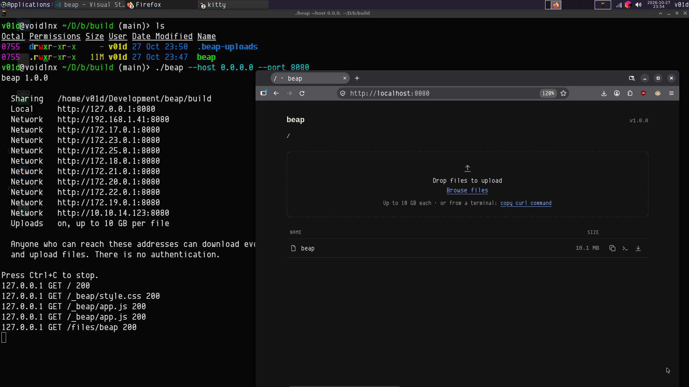

# beap

[](https://hex.pm/packages/beap)
[](https://hexdocs.pm/beap/)
[](https://v4rm4n.github.io/beap/)

<p align="center">
  
</p>

<h1 align="center">Beap</h1>

<p align="center">
  Share files. Dirwalk on the browser :)
</p>


Beap is a small HTTP file server for your terminal, in the spirit of
`python -m http.server`, with what that one lacks: uploads (drag and drop,
with real progress, streamed to disk at any size), copyable links and
`curl` commands, and a clean, responsive interface. It is written in
[Bea](https://github.com/the-bea-project/bea), runs on the Erlang VM, and
needs no internet connection: the page, its stylesheet and its script are
all built in.



## Install

Beap is built with [Bea](https://the-bea-project.github.io/website), which needs Erlang/OTP and Gleam:

```sh
git clone <this repository> beap && cd beap
bea run -- --help             # run from the source
bea pack -o ~/.local/bin/beap # or build a standalone executable (gleepack)
```

## Run

```sh
beap                          # share the current directory on 127.0.0.1:8000
beap 127.0.0.1 8000           # host and port, as arguments
beap --port 9000
beap --host 0.0.0.0 --port 8000   # reachable from other devices
beap --dir ./shared
beap --no-upload              # read-only
beap --max-upload 2G          # largest upload accepted (default 10G)
bea run -- --dir ~/Downloads  # the same, from the source
```

On Windows, paths work as usual: `beap.exe --dir C:\Users\me\Desktop` or
`--dir .\shared`. Names Windows can't store (with `\ : * ? " < > |`, ending
with a dot or space, or `CON`, `NUL`, `COM1`...) are refused for uploads.

| Option | Default | |
| --- | --- | --- |
| `--host HOST` | `127.0.0.1` | interface to listen on: `0.0.0.0` for all IPv4 ones, `::` for IPv6 |
| `--port PORT` | `8000` | `0` picks a free port |
| `--dir DIR` | `.` | directory to share |
| `--no-upload` | uploads on | share read-only |
| `--max-upload SIZE` | `10G` | per file: bytes, or `K`, `M`, `G`, `T` (multiples of 1024) |
| `-h`, `--help` | | |

Options also take the `--port=9000` form. On start, Beap prints the shared
directory, the addresses to open (with the machine's network addresses
when bound to all interfaces) and whether uploads are on.

## In the browser

Open the address Beap prints. Folders come first, then files, by name; a
folder opens with a click, and the breadcrumbs lead back up. Each file has:

- **Copy link**: its URL, as you reached Beap (from another machine, that
  machine's view of the address, not `127.0.0.1`);
- **curl commands**: download and upload commands, quoted for the shell;
- **Download**.

To upload into the folder shown, drop files anywhere on the page or use
**Browse files**. Each upload shows its progress (sent, total, percentage)
and can be cancelled; the listing refreshes when they are done. A file
that exists already is never replaced: the upload is saved as
`notes (1).txt`.

## From a terminal

```sh
curl -fL -O 'http://127.0.0.1:8000/files/archive.tar.gz'          # download
curl -fL -C - -O 'http://127.0.0.1:8000/files/archive.tar.gz'     # resume one
curl -T archive.tar.gz 'http://127.0.0.1:8000/upload/'            # upload
curl -T archive.tar.gz 'http://127.0.0.1:8000/upload/backups/'    # into a folder
curl -T notes.txt 'http://127.0.0.1:8000/upload/renamed.txt'      # under a name
```

`curl -T` streams the file; `curl --data-binary @file -X PUT` works too,
but curl reads all of the file into memory first. A successful upload
answers `201 Created` with the name it was saved under and its URL.

| Request | |
| --- | --- |
| `GET /`, `GET /files/<folder>/` | the folder's page |
| `GET /files/<file>` | the file, as a download (`Range` supported) |
| `PUT /upload/<folder>/<name>` | saves the body as `<folder>/<name>` |

## How uploads work

The body of a `PUT` is read from the socket 64 KiB at a time, and each
piece is on its way to the disk before the next is read: memory stays flat
whatever the size, and a disk slower than the network slows the sender
down instead of filling memory. The browser sends files the same way
(a raw `PUT`, not a form), so its progress is the transfer's.

An upload is written to a new file in `.beap-uploads/`, in the shared
directory, which is never listed or served. Once complete and flushed to
disk, it gets its name with a hard link, atomically and never over an
existing file, then the temporary file goes. A failed, cancelled or
interrupted upload leaves nothing behind, and leftovers from a killed
server are cleared when it starts again.

## Security

- **There is no authentication.** Anyone who can reach the address can
  download every file in the shared directory and, unless `--no-upload`,
  upload files to it. The default address, `127.0.0.1`, only accepts this
  machine; `--host 0.0.0.0` opens it to your network, and Beap says so when
  it starts. Use it on networks you trust, and stop it when you are done.
- Paths are checked segment by segment (`..`, an encoded `/`, NUL are
  refused) and resolved like `realpath`, symbolic links included: nothing
  outside the shared directory is served or written to, even through a
  link. Links within it work.
- Uploads only create files, in existing folders (`O_EXCL`, then a hard
  link): they never replace or follow anything, and never create folders.
- Files are always sent as downloads (`Content-Disposition: attachment`,
  `nosniff`, a sandboxing CSP): an uploaded HTML file can't run scripts on
  Beap's origin. The interface loads nothing but its own stylesheet and
  script, under a strict Content Security Policy.
- Uploads are limited in size (`--max-upload`). One that announces a
  larger size is refused before its body is read (curl, waiting for
  `100 Continue`, doesn't even send it); the page checks sizes first.

## Limitations

- Plain HTTP only: no TLS. Copying to the clipboard from another machine
  relies on a fallback, since browsers only allow the clipboard API on
  secure origins.
- Folders can't be uploaded (only their files), or created from the page.
- On filesystems without hard links (FAT, exFAT), uploads are renamed into
  place instead, which can't fully rule out two uploads racing for one name.
- The upload folder must be on the same filesystem as `.beap-uploads/`
  (a different filesystem mounted inside the shared directory is refused).
- The checks against symbolic links happen when a request arrives: someone
  who can change the shared directory's files on this machine could swap a
  folder for a link meanwhile. Network clients can't create links.
- On Windows, network shares (`\\server\share`) can't be shared; map them
  to a drive letter first.
- Free disk space isn't checked in advance: an upload that fills the disk
  fails with `507` and is removed.

## Development

```sh
bea check
bea test           # unit and end-to-end tests (uploads of 256 MiB to $TMPDIR)
bea format src
```

Beap is a tool, not a library: `src/beap.bea` holds `main`, and everything
else is in `src/beap/internal/`, which Gleam keeps out of the package's
public API and documentation. There: `config` (command line), `server`,
`router` (requests to responses), `paths` (safe path resolution), `fs`
(listings), `upload` (streaming uploads), `share` (links and curl
commands), `html` and `assets` (the interface), and `runtime/` (the few
Erlang functions Beap needs: exclusive files, link reading, and a
workaround for ewe 9.0.0 keeping uploads in memory).
